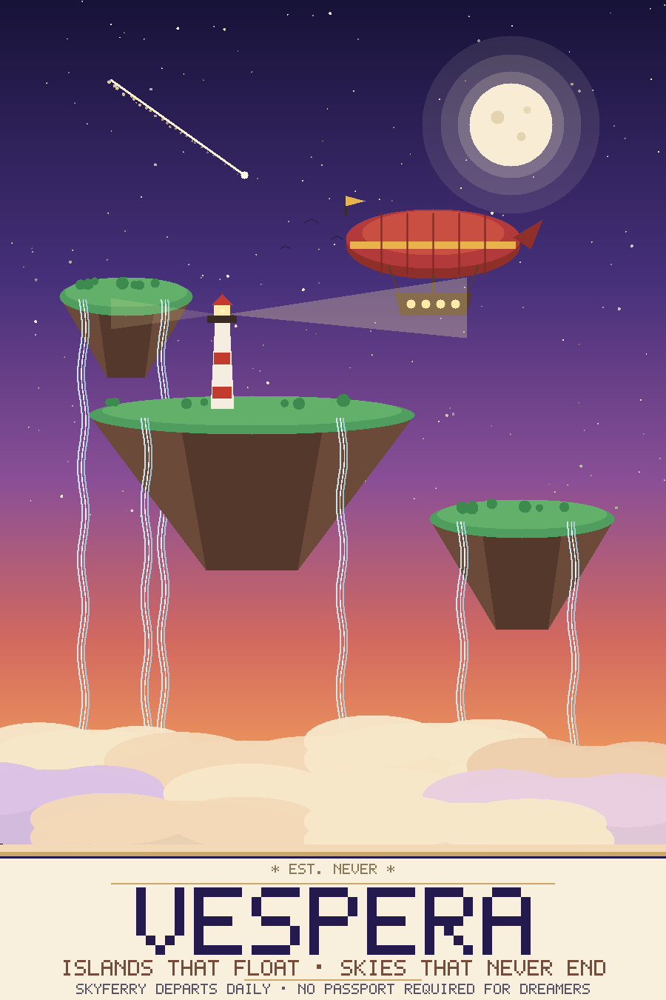

# VESPERA — A Travel Poster for a Place That Does Not Exist

[](https://make.fun/bounty/the-poster-for-a-place-that-i-2-20261121-0539?utm_source=github&utm_medium=readme&utm_campaign=the-poster-for-a-place-that-i-2-20261121-0539)
[](https://make.fun/bounty/the-poster-for-a-place-that-i-2-20261121-0539/leaderboard?utm_source=github&utm_medium=readme&utm_campaign=the-poster-for-a-place-that-i-2-20261121-0539)
[](https://make.fun/bounty/the-poster-for-a-place-that-i-2-20261121-0539?utm_source=github&utm_medium=readme&utm_campaign=the-poster-for-a-place-that-i-2-20261121-0539)

A vintage-style travel poster for **VESPERA**, an island chain that floats
above a sea of clouds. Waterfalls pour off the rim of the isles and vanish
into the clouds below; a red-banded lighthouse sweeps its beam across the
dusk; a skyferry airship drifts between the islands under a full moon and
a shooting star.

> *Islands that float · Skies that never end*
>
> Skyferry departs daily · No passport required for dreamers

## How it is made

`main.ts` (Node 22, stdlib only) draws the whole poster pixel by pixel with
its own PNG encoder — gradient dusk sky, stars, moon, shooting star,
floating isles, waterfalls, lighthouse, airship, cloud sea, and the classic
poster band with a 5×7 pixel font. No assets, no dependencies, no network.

```sh
node main.ts   # writes /output/entry.png and output/entry.png
```

The output is deterministic: identical SHA-256 on every run.


